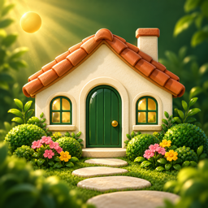
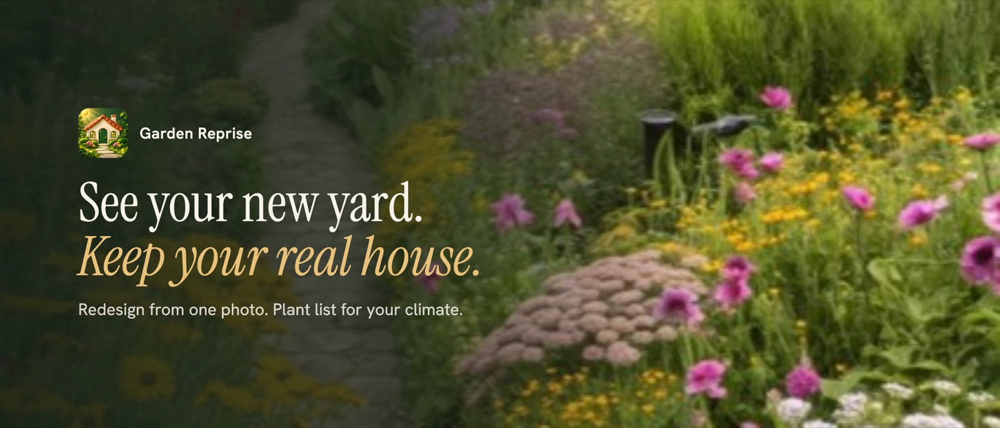
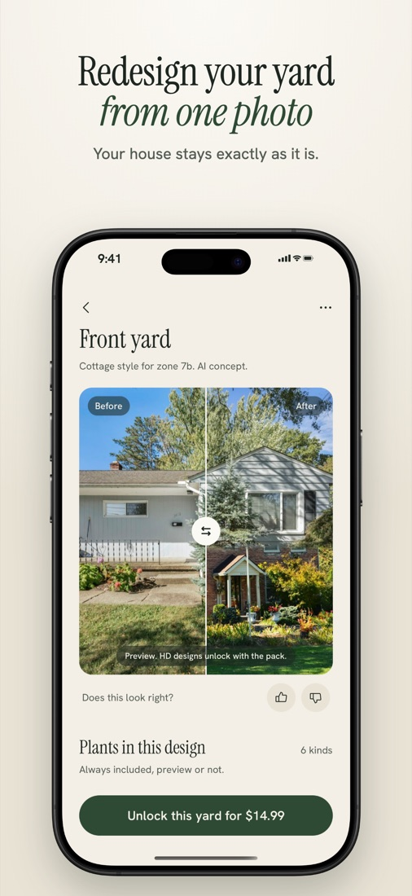
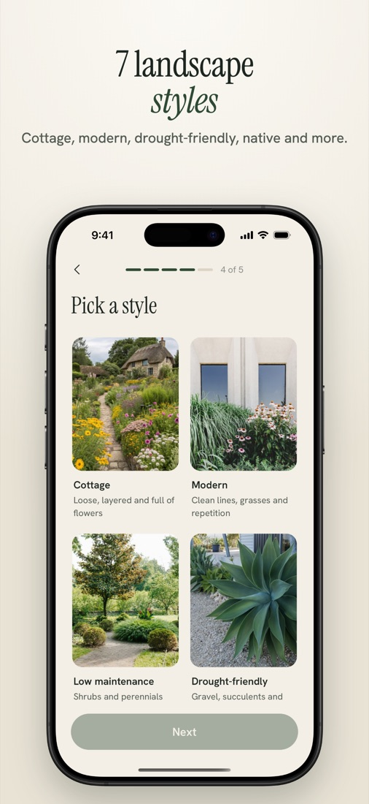
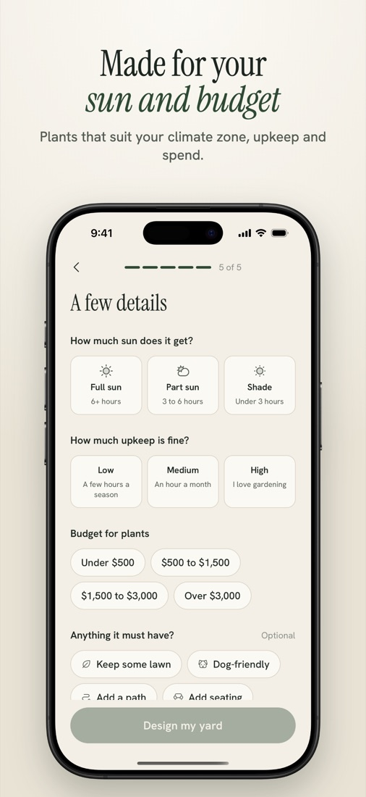

# Garden Reprise: AI landscape design from one photo

Garden Reprise is an iPhone app that redesigns your yard from one photo: paint what you want to change, pick a style, and your house stays exactly as it is.

[Download on the App Store](https://apps.apple.com/app/apple-store/id6828341834?pt=128676461&ct=github-readme&mt=8) · [Website](https://plants.dailyappslab.com/garden-reprise/)

## How it works

Take a photo of your front yard or backyard. Paint over the lawn, beds or patio you want to change, then pick one of seven styles: cottage, modern, low-maintenance, drought-friendly, native and pollinator, Japanese or tropical. Set your sun exposure and budget. Only the painted areas change. The house, driveway and fence are kept from the original photo.

The app matches plants to your USDA hardiness zone from the ZIP code you type in, without location access. The plant list shows why each plant fits, how many to buy, a rough cost, and pet-safety and care notes. You can ask for edits in plain words, such as "add a stone path" or "more color", compare before and after, and export a planting plan PDF.

| Before and after | Styles | Plant details |
|---|---|---|
|  |  |  |

## Price

The first design preview is free, with no account or card. The Yard Makeover Pack is a one-time $14.99 for one yard project and includes 6 HD designs, 20 edits, the full plant list and the planting plan PDF. 20 more edits cost $4.99. There is no subscription.

Designs are AI concepts for planning, not exact results. iPhone only (iOS 16.4 or later), US only for now.

## Yard guides

- [AI landscape design: what it gets right and what it gets wrong](https://plants.dailyappslab.com/guides/ai-landscape-design/)
- [Front yard landscaping ideas by style, checked for your zone](https://plants.dailyappslab.com/guides/front-yard-landscaping-ideas/)
- [Small front yard landscaping ideas that stay low maintenance](https://plants.dailyappslab.com/guides/small-front-yard-ideas/)
- [Low maintenance landscaping: what really cuts yard work](https://plants.dailyappslab.com/guides/low-maintenance-landscaping/)

## About this repository

The app's source code is private. This repository holds the app's public page and screenshots. Questions are welcome as [issues](https://github.com/dailyappslab/garden-reprise/issues).

Made by [Javed Iqbal](https://github.com/javediqbal-byte) at [Daily Apps Lab](https://dailyappslab.com/).
